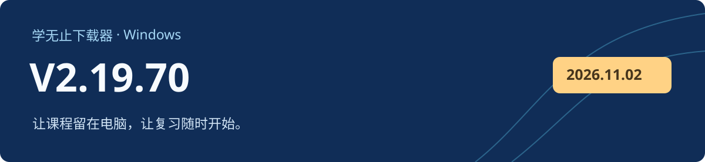

# 学无止下载器 V2.19.70

Windows 客户端 · 2026-11-03 · 正式版

## 下载与校验

从下方资产下载 `xuewuzhi-downloader-2.19.70-windows.exe`。GitHub 自动生成的 Source code 压缩包只包含公开文档与离线骨架，不能构建完整客户端。[官网备用下载](https://www.xuewuzhi.cn/downloader)

| 文件 | 用途 | 大小 |
| --- | --- | --- |
| `xuewuzhi-downloader-2.19.70-windows.exe` | 官方 Windows 客户端 | 267.86 MiB（280,875,384 字节） |
| `SHA256SUMS.txt` | 文件完整性校验 | 文本文件 |

```text
d1de3a878182da81166d1cefd038d814592ca5cac639bfad7d1c77c8dd71e913  xuewuzhi-downloader-2.19.70-windows.exe
```

```powershell
Get-FileHash -LiteralPath '.\xuewuzhi-downloader-2.19.70-windows.exe' -Algorithm SHA256
Get-AuthenticodeSignature -LiteralPath '.\xuewuzhi-downloader-2.19.70-windows.exe'
```

发布前已验证该安装包的 Windows Authenticode 签名和时间戳。实际可下载内容取决于原平台权限、课程开放状态及资源可用性。公开骨架采用 MIT 许可；官方客户端及第三方组件按各自条款提供。
