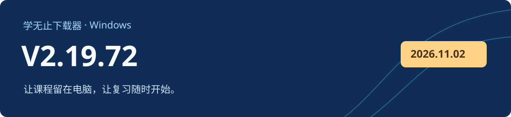

# 学无止下载器 V2.19.72

Windows 客户端 · 2026-11-07 · 正式版

## 更新方式

V2.19.70、V2.19.71 可选择升级，也可暂时继续使用当前版本。V2.19.72 不会提示重复安装；更早已停用的版本沿用原有升级要求。没有自动更新功能、更新入口失效或自动更新失败的旧版本，请从官网或本页下载后覆盖安装。

## 本次修复

- 修复安装结束自动启动时的参数处理及相关启动异常。
- 完善课程下载授权续期、下载中断与继续下载处理。
- 调整下载进度与速度统计，区分网络传输和后续处理阶段。
- 保留更新时对已有登录状态与 Cookie 文件的兼容读取。

## 下载与校验

下载下方的 `xuewuzhi-downloader-2.19.72-windows.exe`。GitHub 自动生成的 Source code 压缩包仅含公开文档和离线骨架，不能构建完整客户端。[官网备用下载](https://www.xuewuzhi.cn/downloader)

| 文件 | 用途 | 大小 |
| --- | --- | --- |
| `xuewuzhi-downloader-2.19.72-windows.exe` | 官方 Windows 客户端 | 290.77 MiB（304,899,032 字节） |
| `SHA256SUMS.txt` | 文件完整性校验 | 文本文件 |

```text
7ad619df87497e447f572615117dc3fdfa3688e6b840ddef16fd82f6563551ab  xuewuzhi-downloader-2.19.72-windows.exe
```

```powershell
Get-FileHash -LiteralPath '.\xuewuzhi-downloader-2.19.72-windows.exe' -Algorithm SHA256
Get-AuthenticodeSignature -LiteralPath '.\xuewuzhi-downloader-2.19.72-windows.exe'
```

安装包包含有效的 Windows Authenticode 签名和时间戳。实际可下载内容取决于原平台权限、课程开放状态及资源可用性。公开骨架采用 MIT 许可；官方客户端与第三方组件按各自条款提供。
