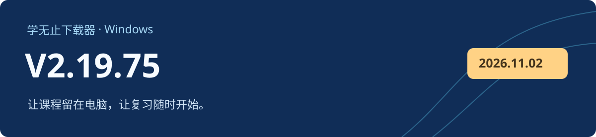

# 学无止下载器 V2.19.75

Windows 客户端 · 2026-11-08 · 正式版

## 更新方式

V2.19.70～V2.19.74 用户可选择升级至 V2.19.75，也可暂时继续使用当前版本；已退役旧版沿用原有升级要求。 V2.19.75 不会重复提示安装自身。没有自动更新能力或更新失败的旧版，可从本页或官网下载后覆盖安装。

## 本次修复与改进

- 修复打包后的公共课程视频下载路径，并覆盖 ClassIn、钉钉等适配流程的本地回归。
- 完善 ClassIn 新设备登录、登录恢复及已有登录状态检查。
- 对齐试下载额度结束、文件已存在和充值确认的统一交互。
- 修复并验证安装后自动启动、更新下载进度与旧安装包清理流程。

## 下载与校验

下载 `xuewuzhi-downloader-2.19.75-windows.exe`，并按下方步骤核对签名和 SHA-256。

GitHub 自动生成的 Source code 压缩包只包含公开文档和离线骨架，不是完整客户端。[官网入口](https://www.xuewuzhi.cn/downloader)

| 文件 | 用途 | 字节数 |
| --- | --- | ---: |
| `xuewuzhi-downloader-2.19.75-windows.exe` | 默认原生保护版 | 287,146,400 |
| `SHA256SUMS.txt` | SHA-256 校验文件 | 106 |

```text
aaf8b2d3e4142b4d4757f8e8a16bec966fc4d6c094197a2c01abba0ab1add844  xuewuzhi-downloader-2.19.75-windows.exe
```

```powershell
Get-FileHash -LiteralPath '.\xuewuzhi-downloader-2.19.75-windows.exe' -Algorithm SHA256
Get-AuthenticodeSignature -LiteralPath '.\xuewuzhi-downloader-2.19.75-windows.exe'
```

安装包带有效的 Windows Authenticode 签名及时间戳。本轮采用隔离环境和本地模拟资源验证，不能代表每个网站的每个真实账号或所有 Windows/网络配置均已实测。可下载内容仍取决于原平台权限、课程开放状态和资源完整性。公开骨架采用 MIT 许可；官方客户端与第三方组件按各自条款分发。
