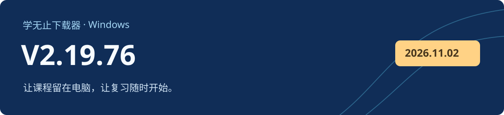

# 学无止下载器 V2.19.76

Windows 客户端 · 2026-11-10 · 正式版

## 更新方式

V2.19.70～V2.19.75 用户可选择升级至 V2.19.76，也可继续使用当前版本；已退役旧版沿用原有升级要求。76 版不会重复提示安装自身。自动更新失败时，可从本页或官网下载后覆盖安装。

已发布的 V2.19.72～V2.19.74 存在自动更新模块异常，请直接下载本版覆盖安装。

## 本次更新

- 改善用户目录重定向、已迁移资料与旧版进程并存、短暂文件占用时的启动兼容性。
- 改善中文和特殊字符下载路径、缓存清理与断点续传，并保留用户取消操作的处理方式。
- 改善登录界面显示、通用下载代理接管与共存；服务端继续支持 70～76 版客户端。
- 完成课程选择、课程视频、更新下载进度和覆盖安装后的启动回归，核对已有课程文件的保留情况。

## 下载与校验

下载 `xuewuzhi-downloader-2.19.76-windows.exe`，并核对 SHA-256 与 Windows 签名。GitHub 自动生成的 Source code 压缩包只包含公开文档和离线骨架。[官网入口](https://www.xuewuzhi.cn/downloader)

| 文件 | 字节数 |
| --- | ---: |
| `xuewuzhi-downloader-2.19.76-windows.exe` | 287,592,928 |
| `SHA256SUMS.txt` | 106 |

```text
443811724d3c6d71521c67772685b58a32c8b6e552011cfd98e86620ec101c1c  xuewuzhi-downloader-2.19.76-windows.exe
```

```powershell
Get-FileHash -LiteralPath '.\xuewuzhi-downloader-2.19.76-windows.exe' -Algorithm SHA256
Get-AuthenticodeSignature -LiteralPath '.\xuewuzhi-downloader-2.19.76-windows.exe'
```

安装包带有效的 Windows Authenticode 签名和时间戳。本轮采用隔离环境与本地模拟资源验证，未使用真实平台账号测试。
