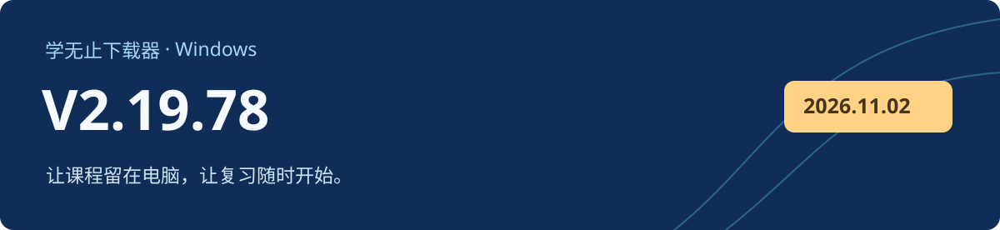

# 学无止下载器 V2.19.78

Windows 客户端 · 2026-11-13 · 正式版

## 更新方式

V2.19.70～V2.19.77 用户可选择升级至 V2.19.78，也可跳过并继续使用当前版本。已退役旧版沿用原有升级要求；78 版不会重复提示安装自身。自动更新失败时，可从本页或官网下载后覆盖安装。

已发布的 V2.19.72～V2.19.74 存在自动更新模块异常，请直接下载本版覆盖安装。

## 本次更新

- 改善红果课程处理、北辰预约课程、百度链接参数与 CCtalk 回放兼容性。
- 改善 Polyv 媒体处理及资源同步，覆盖长片段、无音频片段和不同帧率的合并场景。
- 改善课程选择、下载授权、断点恢复和通用下载的兼容性，并更新运行文件完整性校验。
- 服务端支持 70～78 版客户端，70～77 版保持可用。

## 下载与校验

下载 `xuewuzhi-downloader-2.19.78-windows.exe`，并核对 SHA-256 与 Windows 签名。GitHub 自动生成的 Source code 压缩包只包含公开文档和离线骨架。[官网入口](https://www.xuewuzhi.cn/downloader)

| 文件 | 字节数 |
| --- | ---: |
| `xuewuzhi-downloader-2.19.78-windows.exe` | 287,280,392 |
| `SHA256SUMS.txt` | 106 |

```text
268c25084edfa3b3f0b2ddc9668a13d16bc219f5111c7e0041fb401c8d41484d  xuewuzhi-downloader-2.19.78-windows.exe
```

```powershell
Get-FileHash -LiteralPath '.\xuewuzhi-downloader-2.19.78-windows.exe' -Algorithm SHA256
Get-AuthenticodeSignature -LiteralPath '.\xuewuzhi-downloader-2.19.78-windows.exe'
```

安装包已通过 Windows 签名、时间戳和压缩完整性验证，并通过隔离环境中的功能回归及包内媒体处理测试。本轮未使用真实第三方账号进行登录、购买或付费下载测试；Windows 7 兼容性仅完成静态检查。
