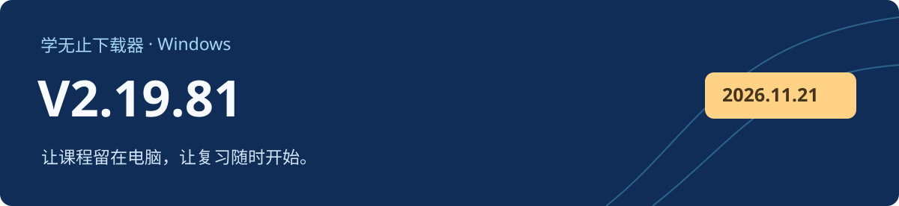

# 学无止下载器 V2.19.81

Windows 客户端 · 2026-11-21 · 正式版

## 更新方式

V2.19.78～V2.19.80 用户可选择升级至 V2.19.81，也可跳过并继续使用当前版本。已退役旧版沿用原有升级要求；81 版不会重复提示安装自身。自动更新失败时，可从本页或官网下载后覆盖安装。

## 本次更新

- 改善课程选择、视频与课件下载、资源恢复和媒体处理的兼容性。
- 修复下载授权停止后的任务处理，改善登录窗口与会话衔接。
- 更新运行文件完整性校验及启动保护，并完成安装后的下载与安全回归验证。

## 下载与校验

下载 `xuewuzhi-downloader-2.19.81-windows.exe`，并核对 SHA-256 与 Windows 签名。GitHub 自动生成的 Source code 压缩包只包含公开文档和离线骨架。[官网入口](https://www.xuewuzhi.cn/downloader)

| 文件 | 字节数 |
| --- | ---: |
| `xuewuzhi-downloader-2.19.81-windows.exe` | 287,575,296 |
| `SHA256SUMS.txt` | 106 |

```text
f98759fd38a70e518bcc5550fc367a2aef48a5185775925f975ce6f4bd8d6d78  xuewuzhi-downloader-2.19.81-windows.exe
```

```powershell
Get-FileHash -LiteralPath '.\xuewuzhi-downloader-2.19.81-windows.exe' -Algorithm SHA256
Get-AuthenticodeSignature -LiteralPath '.\xuewuzhi-downloader-2.19.81-windows.exe'
```

安装包的签名状态应为 `Valid`，发布者为“杭州学无止软件有限公司”。安装包已完成实际安装、启动、媒体传输、运行文件完整性及安全回归验证。测试范围与可用资源仍取决于平台、账号权限和课程开放情况。
