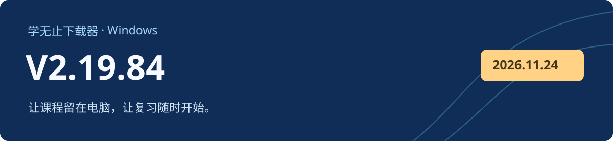

# 学无止下载器 V2.19.84

Windows 客户端 · 2026-11-24 · 正式版

## 更新方式

V2.19.78～V2.19.83 用户可选择升级至 V2.19.84，也可跳过并继续使用当前版本。已退役旧版沿用原有升级要求；84 版不会重复提示安装自身。自动更新失败时，可从本页或官网下载后覆盖安装。

## 本次更新

- 完善东奥 App 登录、课程选择及视频、课件下载，改善异常账号状态与损坏文档的处理。
- 完善金软金盾课程目录读取和视频解码流程。
- 改善万能下载及部分平台的媒体、HLS 和课件下载兼容性。
- 修复部分 Windows 环境下的启动兼容问题；本次安装包已完成 Win7 SP1、Win10、Win11 的启动及合成媒体下载验证。

## 下载与校验

下载 `xuewuzhi-downloader-2.19.84-windows.exe`，并核对 SHA-256 与 Windows 签名。GitHub 自动生成的 Source code 压缩包只包含公开文档和离线骨架。[官网入口](https://www.xuewuzhi.cn/downloader)

| 文件 | 字节数 |
| --- | ---: |
| `xuewuzhi-downloader-2.19.84-windows.exe` | 288,806,568 |
| `SHA256SUMS.txt` | 106 |

```text
dd33eb0ad09199f4c8f93bc70ddb1a827c225591cb462a20df41c03289b99a95  xuewuzhi-downloader-2.19.84-windows.exe
```

```powershell
Get-FileHash -LiteralPath '.\xuewuzhi-downloader-2.19.84-windows.exe' -Algorithm SHA256
Get-AuthenticodeSignature -LiteralPath '.\xuewuzhi-downloader-2.19.84-windows.exe'
```

安装包的签名状态应为 `Valid`，发布者为“杭州学无止软件有限公司”。安装包已完成实际安装、启动、媒体传输、运行文件完整性及安全回归验证。测试范围与可用资源仍取决于平台、账号权限和课程开放情况。
