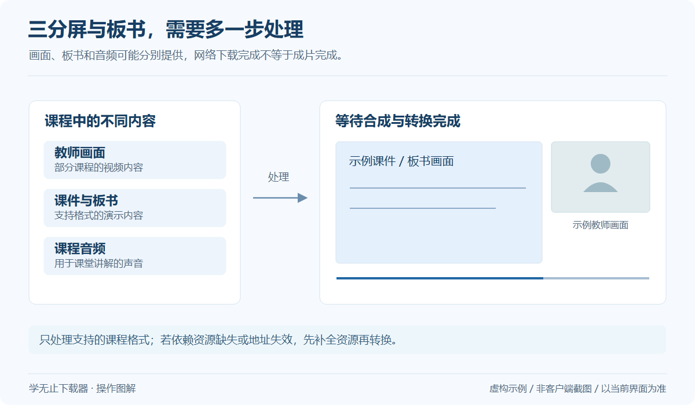

# 四海公考视频下载教程

下载四海公考已开通的课程、直播回放和课件，并处理支持格式的板书与三分屏课程。

**分类：** 网课与学习平台

**客户端入口：** `四海公考(三分屏)`

| 项目 | 说明 |
| --- | --- |
| 平台 / 工具 | 四海公考 |
| 使用方式 | 平台列表 |
| 运行环境 | 官方 Windows 客户端 V2.19.62 |
| 操作资料 | [官网公开教程](https://www.xuewuzhi.cn/sihaigongkao_downloader) · 快照 2026-10-19 |

## 开始之前

准备自己有权访问的账号与内容，先确认原平台可正常打开。客户端账号不替代课程或文件的访问权限。

## 操作步骤

*通用操作示意，具体界面以当前版本为准。* [查看大图](../../assets/guides/board-conversion.png)

1. 打开 Windows 版学无止下载器，在首页输入 A 并回车，选择“四海公考(三分屏)”。
2. 在四海公考登录窗口登录上课账号，核对 sihaigongkao.mddclass.com 的学习中心与课程列表。
3. 选择需要的课程、章节和下载模式，按实际提供的内容选择视频、回放、课件或三分屏处理。
4. 确认保存目录并等待下载、合并及板书渲染完成，再抽查生成视频的声音、讲师画面和课件时间线。

## 这个入口的说明

- 四海公考有独立的平台入口；即使网页域名包含 mddclass，也应选择“四海公考(三分屏)”登录和加载课程。
- 只处理当前账号可访问且已经开放的内容。三分屏或板书资源需要额外生成视频，请等全部处理结束后再关闭软件。
- 资料类型取决于原课程，不能把板书或课件画面一概视为可下载的原始 PPT。

## 常见问题

### 四海公考为什么需要单独选择入口？

四海公考使用自己的课程空间和登录上下文。请选择“四海公考(三分屏)”，并确认当前账号在四海学习中心能够播放所选课程。

## 完成后如何检查

确认下载及后续处理全部结束，再打开输出。视频抽查开头、中间与结尾；文档及其他文件检查能否正常打开，文件夹任务还应核对所选范围和子目录。

## 参考与下一步

- [下载官方 Windows 客户端](https://github.com/Xue-Wu-Zhi/xuewuzhi-downloader/releases/latest)
- [官网公开教程](https://www.xuewuzhi.cn/sihaigongkao_downloader)
- [完整平台索引](Platforms.md)
- [排错指南](Troubleshooting.md)

本页按 V2.19.62 和 2026-10-19 的官网目录核对，介绍官方客户端的使用方式；本仓库不包含对应的核心实现。资源范围以平台、账号权限及当前客户端提示为准。
