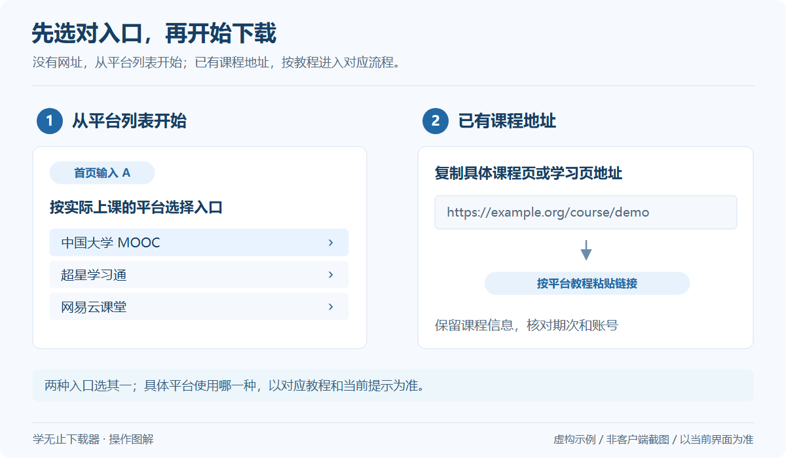

# 智拾网视频下载教程

下载智拾网已购课程中的视频、音频、图文与资料；图文课时按支持的方式保存为 PDF。

**分类：** 网课与学习平台

**客户端入口：** `智拾网`

| 项目 | 说明 |
| --- | --- |
| 平台 / 工具 | 智拾网 |
| 使用方式 | 平台列表 / 链接 |
| 运行环境 | 官方 Windows 客户端 V2.19.62 |
| 操作资料 | [官网公开教程](https://www.xuewuzhi.cn/zhi10_downloader) · 快照 2026-10-19 |

## 开始之前

准备自己有权访问的账号与内容，先确认原平台可正常打开。客户端账号不替代课程或文件的访问权限。

## 操作步骤

*通用操作示意，具体界面以当前版本为准。* [查看大图](../../assets/guides/choose-entry.png)

1. 打开 Windows 版学无止下载器，在首页输入 A 并回车，选择“智拾网”；也可粘贴支持的智拾网课程链接。
2. 登录购买课程的智拾网账号，等待已购课程列表显示，并确认所选课程在官网可正常打开。
3. 展开课程并选择需要的课时，按实际提供的内容选择视频、音频或资料；只需附件时选择仅资料模式。
4. 确认保存目录并开始下载，完成后分别检查媒体播放、图文 PDF 和原格式附件。

## 这个入口的说明

- 视频、音频、图文与附件随课程而异，当前账号有权访问且已开放的内容才能进入下载流程。
- 图文课时可按支持方式转为 PDF，课程附带文件按其实际格式保存；两者不是同一种资源。

## 常见问题

### 能打开课程列表却不能下载某节课怎么办？

先在智拾网官网用同一账号打开该课时，确认访问权限、开放时间与资料是否存在，再核对客户端选中的课程和内容类型。

## 完成后如何检查

确认下载及后续处理全部结束，再打开输出。视频抽查开头、中间与结尾；文档及其他文件检查能否正常打开，文件夹任务还应核对所选范围和子目录。

## 参考与下一步

- [下载官方 Windows 客户端](https://github.com/Xue-Wu-Zhi/xuewuzhi-downloader/releases/latest)
- [官网公开教程](https://www.xuewuzhi.cn/zhi10_downloader)
- [完整平台索引](Platforms.md)
- [排错指南](Troubleshooting.md)

本页按 V2.19.62 和 2026-10-19 的官网目录核对，介绍官方客户端的使用方式；本仓库不包含对应的核心实现。资源范围以平台、账号权限及当前客户端提示为准。
