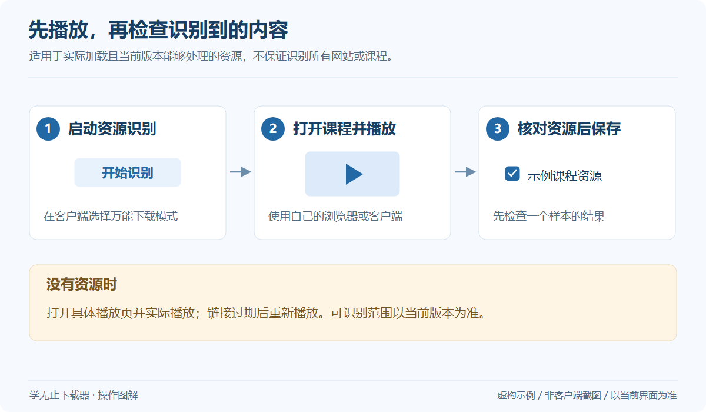

# 万能下载模式

万能下载模式用于在没有合适的专用入口等情况下，辅助识别当前浏览器或课程客户端正在加载的资源。名称不代表对所有网站、格式和课程的支持承诺。

## 使用步骤

*通用操作示意，使用虚构数据；不是客户端截图，具体界面以当前版本为准。* [查看大图](../../assets/guides/universal-mode.png)

1. 在客户端首页输入 `A`，选择“万能下载模式(兜底)”。
2. 按窗口提示启动资源识别。
3. 在你自己的浏览器或课程客户端中登录，实际播放需要保存的内容。
4. 回到资源列表，核对内容、文件名和所需项目。
5. 选择保存位置并开始任务，等待下载及后续处理结束。

## 列表没有出现内容

仅打开课程首页可能不会加载媒体。保持窗口处于提示的工作状态，再刷新具体播放页并开始播放。仍然无法识别时，确认原平台可以播放，并查看客户端有没有具体错误提示。

## 多个资源如何选择

网页可能同时加载预览、音频、分段资源或其他媒体。以客户端可见信息核对所需内容，先处理一个样本并验证，避免一次选中大量无法确认的项目。

## 地址过期与重试

媒体链接往往有有效期。过期后回到原平台重新播放，再识别新的有效资源。不要反复提交已失效地址。

本仓库仅介绍操作流程，不提供资源识别、会话获取或平台解析的实现。[对应公开教程](Platform-universal.md)

## V2.19.62 的识别范围

在电脑或支持的手机采集流程中播放内容，核对已识别的视频、音频和视频号资源，再选择下载。

短视频和社交视频识别范围包括抖音、快手、小红书、微博、西瓜视频、AcFun、TikTok、X / Twitter、Instagram、Facebook、Reddit。小红书视频和图文也可通过首页粘贴支持的分享链接进入；图文不等同于视频嗅探结果。

影视与公共视频识别范围包括优酷、爱奇艺、腾讯视频、好看视频、芒果 TV、搜狐视频、CCTV央视频、红果短剧。抖音付费短视频不支持；抖音课堂课程请使用对应专用入口。

其他视频站点包括 YouTube、Vimeo、Dailymotion、Twitch；需要当前网络、账号及所在地区可以正常访问和播放。

微信视频号：保持采集开启，再打开并播放需要保存的内容，核对对应的视频或音频条目后下载。缺少匹配播放信息时，关闭后重新打开该条内容并播放，再重试。

手机采集请按客户端显示的连接步骤操作；只有实际加载并成功识别的资源才会进入列表，任务结束后按提示恢复手机网络设置。

以上是 V2.19.62 的站点识别范围，具体资源还受账号权限、地区、平台开放范围和链接有效期影响；DRM 保护内容不支持下载。

[查看站点与操作说明](Platform-universal.md)
